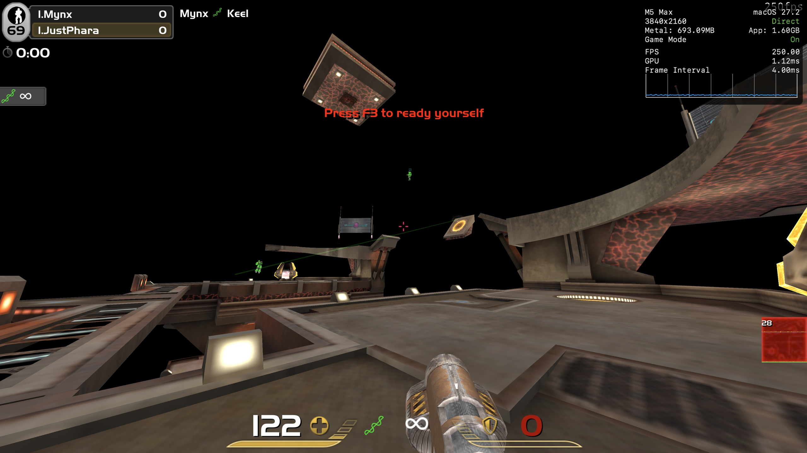
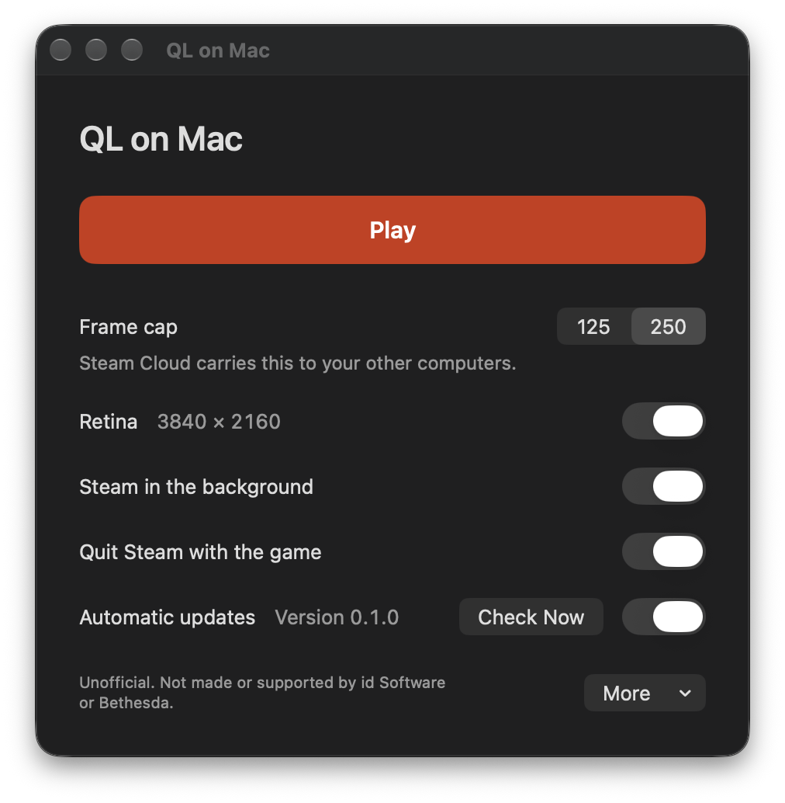

# QL on Mac

I play [Quake Live](https://store.steampowered.com/app/282440/Quake_Live/) on an Apple silicon
Mac, and under [CrossOver](https://www.codeweavers.com/crossover) it gave me 60 to 70 fps with
stutter. Quake Live is an OpenGL 1.x game,
and on a Mac that OpenGL ends up in Apple's legacy driver, which nobody has worked on in years.
So I wrote [**glmt**](glmt/README.md), a translator that takes the game's OpenGL calls to Metal
directly, and put it into an arm64 [Wine](https://gitlab.winehq.org/wine/wine) that runs the
game's x86 code with [FEX](https://github.com/FEX-Emu/FEX). No Rosetta, no Apple OpenGL, and no
OpenGL-on-Vulkan-on-Metal stack in between.

On my Mac the game now holds its own cap of 250 fps at 3840x2160.



> QL on Mac is an unofficial fan project. id Software and Bethesda don't make, endorse or support
> it. It doesn't host or change the game. Steam comes from Valve and Quake Live comes from Steam.
> Quake Live is a trademark of id Software LLC, Steam of Valve Corporation, Mac of Apple Inc.

## Where it stands

It works on one Mac, mine. That is an M5 Max on macOS 27 with a 4K display at 60 Hz. I have
played duels and public games online and matches against bots on it.

In a ten minute duel at 4K the game made 249.8 frames a second, and one frame in a thousand took
more than one and a half times the median. Those numbers come from glmt's own log.

Nobody else has run it yet. Expect rough edges, and read
[What doesn't work yet](#what-doesnt-work-yet) before you spend an evening on it.

## What you need

- A Mac with Apple silicon. The Wine engine is the one my other project,
  [GW2 on Mac](https://github.com/jdrly/gw2-on-mac), uses, and there it needs macOS 26.5 or later.
  I have only run Quake Live on macOS 27.
- Quake Live on your Steam account.
- About 5 GB of free space for the engine, Steam and the game.

## Install and play

Download `QL-on-Mac-0.1.0.dmg` from the
[latest release](https://github.com/jdrly/ql-on-mac/releases/latest), open it and drag QL on Mac
to Applications. The app is signed with my Developer ID and notarized by Apple.



Install downloads the Wine engine, makes a bottle and runs Valve's Steam installer. Then Steam
opens. You sign in there and install Quake Live. After that the window has Play. The button says
how far the start is while Steam comes up, signs in and launches the game.

The app keeps everything in `~/Library/Application Support/QL on Mac`. More, then Uninstall,
removes it. [`app/README.md`](app/README.md) has the details.

### From the scripts

The scripts do the same from a checkout and compile everything on your Mac. They need Xcode's
command line tools, [Homebrew](https://brew.sh) with `bison`, `freetype` and `pkgconf`, and about
12 GB of free space for the engine, the compiler, Wine's build and the game.

```sh
git clone https://github.com/jdrly/ql-on-mac
cd ql-on-mac
scripts/ql.zsh setup      # the engine, the builds, the bottle, Steam's installer, then Steam's window
scripts/opengl32.zsh build && scripts/opengl32.zsh install    # OpenGL calls in batches
scripts/ql.zsh play       # Quake Live through Steam
```

`setup` downloads athei's [Mach9](https://github.com/athei/mach9) 0.4.0 at a pinned checksum,
compiles what this repository adds, makes a Wine bottle and runs Valve's Steam installer in it.
Then Steam opens. You sign in there and install Quake Live. Run `setup` again if a step fails.
It skips what is done.

Everything lands in `work/` inside the checkout. Deleting that folder removes all of it.

`scripts/ql.zsh` has a few more commands. `stop` ends the Wine session, `status` says what is
installed and running, `debug` starts the game with logs in the terminal, and the script's header
lists the rest.

### Settings for the scripts

The app has its own switches. For the scripts they are environment variables in front of
`scripts/ql.zsh play`.

| Variable | Default | What it does |
|---|---|---|
| `QL_FPS` | 250 | The game's `com_maxfps`. 250 is the game's own limit. 125 is the other value players use. |
| `QL_RES` | the display's pixels | The game's resolution as `WIDTHxHEIGHT`, or `keep` for what your config says. |
| `GLMT_PRESENT` | `async` | How frames reach the display. `tear` presents from the game's thread. `mailbox` syncs to the display and costs a refresh of delay. |
| `QL_SPACE` | 1 | The game's window gets a full-screen Space of its own. |
| `QL_BATCH` | 1 | OpenGL calls cross from the game's 32-bit side in batches. It needs the `opengl32` pair from the install step above. |

The game saves `com_maxfps` and the resolution into its config, and Steam Cloud carries the
config to your other computers.

## How it works

```
quakelive_steam.exe     32-bit x86, run by FEX inside Wine
  opengl32.dll          Wine's, 32-bit. With patches/wine it hands state calls over in batches
  opengl32.so, win32u.so    arm64, Wine's OpenGL function table
  winemac.so            Wine's Mac driver. With patches/wine it fills that table from glmt
  libglmt.dylib         OpenGL 1.x state to draw packets to Metal
Metal
```

Wine's Mac driver normally gives a Windows program Apple's OpenGL or, in this engine,
[Mesa](https://gitlab.freedesktop.org/mesa/mesa)'s [Zink](https://docs.mesa3d.org/drivers/zink.html)
on a Vulkan driver on Metal. The patch in `patches/wine` makes it load `libglmt.dylib` for
`quakelive_steam.exe` and nothing else. Steam and its web helper keep the engine's defaults.

glmt implements the part of OpenGL 1.x that id Tech 3 uses, on Metal. [`glmt/README.md`](glmt/README.md)
describes it.

Three more patches came out of playing.

- The game's menu is a web page, and its text came out as one-pixel dashes. That was a sign bug
  in Wine's font code from 2009, which only a 32-bit program on a 64-bit unix side reaches.
- The game's fullscreen window can take a macOS full-screen Space.
- One OpenGL call cost about 0.4 microseconds to cross from the 32-bit side, and a heavy frame
  makes 6,000 of them. `opengl32` now keeps state calls in a buffer and crosses once per draw.
  A state call went from 333 ns to 28 ns in my test program.

## What doesn't work yet

- **Tearing on a 60 Hz display.** 250 frames a second don't divide into 60. Without display sync
  you see tear lines, and with it macOS shows every frame a refresh late, which I won't play
  with. A display with variable refresh that covers 125 Hz should fix it. I don't own one.
- **The menu is slow.** The game draws its menu as a web page in software, under FEX, at 4K. A
  click can take a second to show. In a match nothing of that is left.
- **`r_gamma` and post-processing.** glmt offers no shaders or framebuffer objects, so the game
  turns bloom and colour correction off, and `r_gamma` changes nothing unless the game uses the
  display's gamma ramp. I haven't tested that path.
- **Other apps can cost you a frame.** A menu bar app that polls on a timer made the picture
  stand still for a refresh every time it ran. I found two of mine that way. Quit what you don't
  need while you play.
- **A call to a null pointer hangs instead of crashing.** That is Wine and FEX on this engine.
  I met it when the game ran out of cvars, see below.

### If the game dies when a bot match starts

The game has room for 2,048 variables. Every `seta` line in your config takes one at start, and a
config carried along since Quake III can hold hundreds that no part of the game reads any more.
Mine had 767. A match with bots loads the server's variables on top, the table overflows, and the
game ends with `MAX_CVARS` in its `error.log`.

```sh
scripts/ql.zsh cvars         # counts them and lists the ones nothing in the game names
scripts/ql.zsh cvars trim    # removes those, and keeps the files as they were in work/backups
```

Steam Cloud carries the trimmed config to your other computers.

## What is in the repository

| Folder | What |
|---|---|
| `glmt/` | The translator. It also has a repository of its own, [jdrly/glmt](https://github.com/jdrly/glmt), with the same code. `make -C glmt test` runs its tests on any system. `make -C glmt` builds `libglmt.dylib` on macOS. |
| `patches/wine/` | Four patches to Wine at the engine's commit. The build takes Wine's source from [my fork](https://github.com/jdrly/wine), which has that commit. |
| `scripts/` | Setup, play and the builds on the Mac. `scripts/ql.zsh` is the one command. |
| `app/` | The app, its build and its release script. |
| `docs/images/` | The pictures in this file. |
| `ci/`, `.github/workflows/` | The build of Wine's patched libraries, used on the Mac and by CI. |

## Licence

LGPL 2.1 or later, the licence of [Wine](https://gitlab.winehq.org/wine/wine), whose code the
patches change. See [`LICENSE`](LICENSE).

The engine is not part of this repository. It is athei's
[Mach9](https://github.com/athei/mach9), which carries Wine, FEX and the rest under their own
licences.

## Thanks

To athei for [Mach9](https://github.com/athei/mach9), an arm64 Wine with FEX that runs 32-bit
games on a Mac without Rosetta. To the [Wine](https://gitlab.winehq.org/wine/wine) and
[FEX](https://github.com/FEX-Emu/FEX) developers. And to id Software for publishing
[Quake III Arena's source](https://github.com/id-Software/Quake-III-Arena), which is where I read
how id Tech 3 draws.
